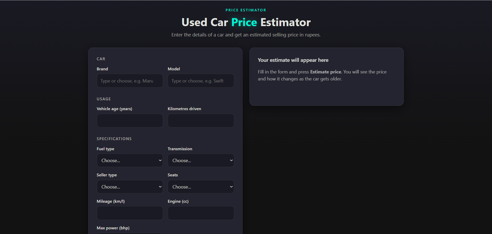
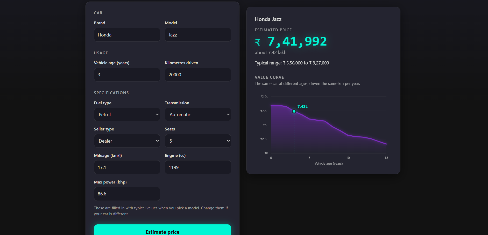
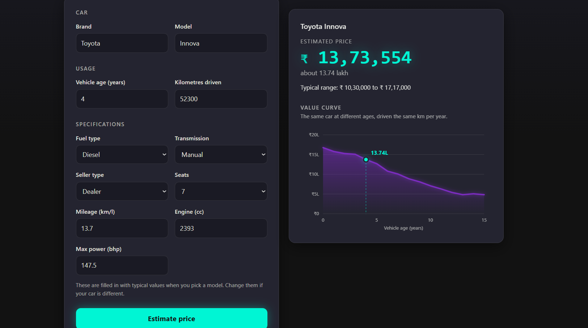

# Used Car Price Estimator

Estimates the selling price (in rupees) of a used car from its brand, model, age, kilometres driven and specifications.
It includes the full workflow (data cleaning, feature engineering, model comparison) and a small website built with Flask.






## How accurate is it?

Be realistic about what this model can do. On cars it never saw during training (the 20% test split):

| Measure | Result |
|---|---|
| Best model | XGBoost |
| Average error | about 12.7% of the price |
| Median error | about 10% |
| Within 10% of the real price | about 52% of cars |
| Within 20% of the real price | about 82% of cars |
| Within 25% of the real price | about 89% of cars |

The website therefore shows a **typical range of about +/-25%** around the estimate, not a single exact price.

**Why not more accurate?** The data has no information about condition, number of owners, accident history, city or exact variant.
About 14% of the cars share exactly the same recorded details with at least one other car, yet sold for very different prices
(for example, 8-year-old diesel Swift Dzire cars with 90,000 km sold from Rs 3,70,000 to Rs 5,50,000).
Even the best possible guess for such cars is off by about 10% (median).
So the limit probably comes from the data.
Treat the result as a guide to the typical price, not as a valuation.

## Quick start
Download the dataset (see [Dataset](#dataset)) and save it as `data/raw.csv`.

From the project root:

```
pip install -r requirements.txt
python app.py
```

Then open http://127.0.0.1:5000

The first start does everything automatically (about a minute): it cleans the data, creates `data/processed.csv`,
compares the models and saves the best one to `artifacts/model.pkl`. Later starts take a few seconds.

To rebuild everything after changing the data or the code:

```
python app.py --retrain
```

To run the steps one by one:

```
python -m src.features     # clean the data and create data/processed.csv
python -m src.train        # compare models and save artifacts/model.pkl
python -m src.predict      # print an example prediction
```

`app.py` starts Flask in debug mode, which is meant for running on your own computer. It is not a production setup.

## Using the website

1. Type or choose a **brand** and a **model**. The model list only shows models of the chosen brand.
2. Picking a model fills in its typical fuel type, transmission, seats, engine, power and mileage. Change them if your car is different.
3. Enter the vehicle age and kilometres driven, and choose the seller type.
4. Press **Estimate price** to see the estimated price, a typical range and a value curve (the same car at ages 0 to 15 with the same kilometres per year).

Brands or models that were not in the training data still get an estimate, with a warning that it is less reliable.

   ## Dataset

   - **Source:** "cardekho" by ozgurcanozel, on [Kaggle](https://www.kaggle.com/datasets/ozgurcanozel/cardekho). Not included in this repository because the page lists no license.
   - **To run the project:** download the CSV from the link above and save it as `data/raw.csv`.
   - **Size:** 15,411 rows, 15,237 after cleaning
   - **Target:** `selling_price` (rupees)


## Project structure

```
ESTIMATOR_PROJECT/
├── app.py                          Flask website
├── templates/index.html            the web page
├── static/style.css, app.js        dark theme, model list and spec autofill
├── src/
│   ├── data_cleaning.py            DataCleaning class (cleaned data kept in data_cleaned)
│   ├── features.py                 final feature table, saves data/processed.csv
│   ├── train.py                    split, pipeline, model comparison, saves the best model
│   └── predict.py                  loads the saved model and predicts one car
├── notebooks/
│   ├── EDA.ipynb                   explore the raw data, decide what to clean
│   ├── Feature_Engineering.ipynb   test feature ideas, keep only the useful ones
│   └── models.ipynb                compare models with cross-validation
├── data/
│   ├── raw.csv                     original data (never changed)
│   ├── processed.csv               made by src/features.py
│   └── train.csv, test.csv         made by src/train.py (optional)
├── artifacts/model.pkl             made by src/train.py
├── docs/images/                    screenshots and plots used in this README
└── requirements.txt
```

## How it works

**1. Cleaning (`src/data_cleaning.py`)** turns 15,411 rows into 15,237:
- drops the old index column and `car_name` (it is just brand + model)
- strips spaces and lowercases all text, so `ISUZU` and `Isuzu` become one brand
- fills missing values (none in this file, but new data may have them)
- removes 167 duplicate rows
- removes impossible values (2 cars with 0 seats)
- removes 5 rows with more than 150,000 km per year (data-entry mistakes)

Genuine expensive cars (for example a Ferrari) are kept. A high price is not an error.

**2. Features (`src/features.py`)** 
I tested km_per_year and power_to_displacement, but neither improved the models, so I removed them.  
Removing vehicle_age clearly hurt (Random Forest error rose from about 12.9% to 14.2%), so it stays.

**3. Training (`src/train.py`)** compares Linear Regression, Random Forest and XGBoost with 5-fold cross-validation and keeps the best.
Inside one pipeline it:
- one-hot encodes `seller_type`, `fuel_type` and `transmission_type`
- target encodes `brand` and `model`
- scales numbers only for Linear Regression (the tree models do not need it)
- trains on the log of the price and converts predictions back to rupees

**4. Prediction (`src/predict.py`)** builds the same features for one car and passes it to the saved pipeline.

## Avoiding data leakage

- Row-by-row features are safe to compute on all the data.
- Encoding and scaling are fitted on the training data only, inside the pipeline.
- The test data is used once, at the end, to report the final score.


## Credits and author

- **Dataset:** "cardekho" uploaded by ozgurcanozel on [Kaggle](https://www.kaggle.com/datasets/ozgurcanozel/cardekho). The dataset page lists no license, so the data file is not included in this repository.
- **Author:** Avni Gupta ([GitHub](https://github.com/AvniGupta09))

This is a learning project.